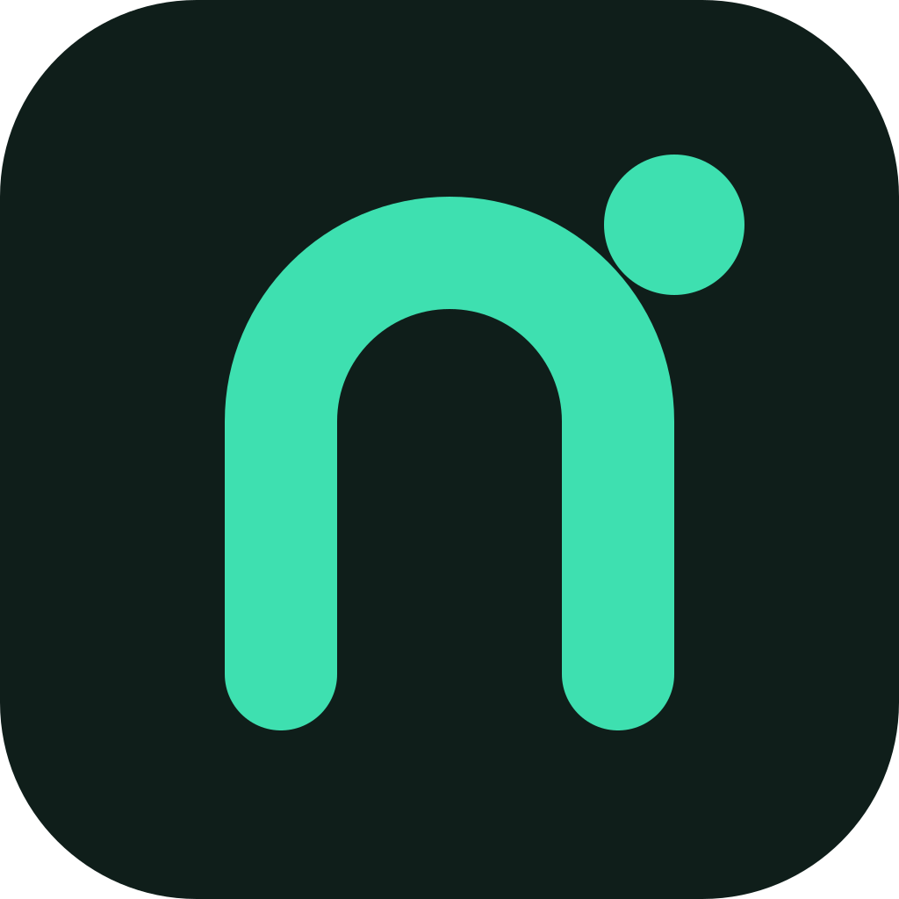
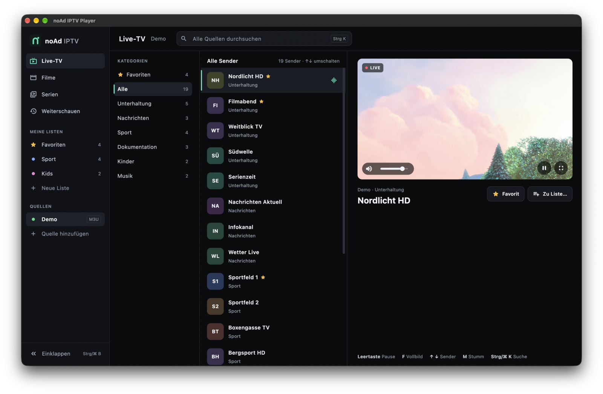
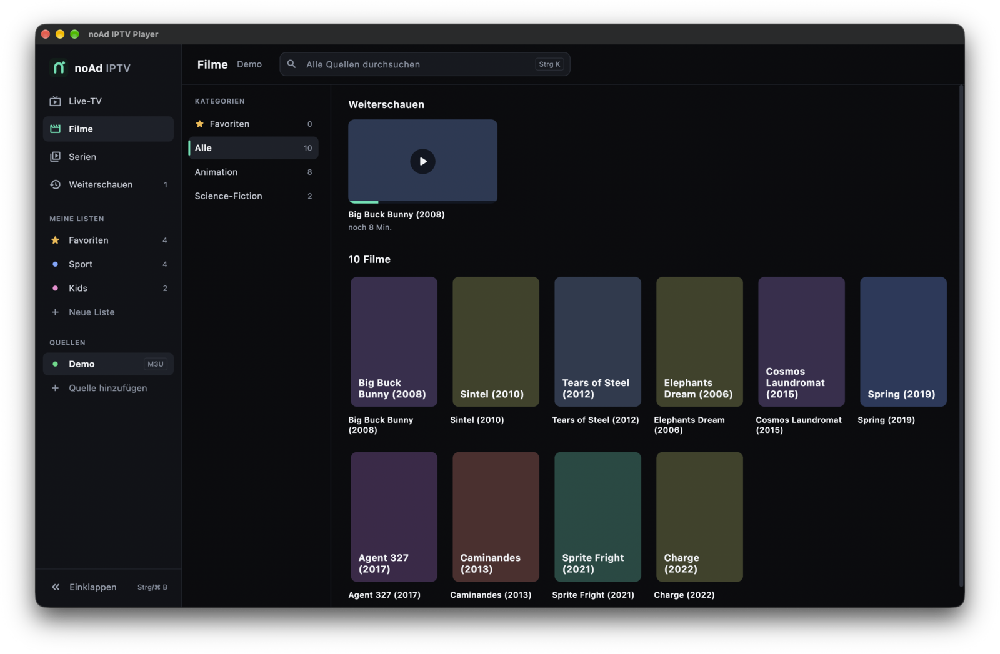
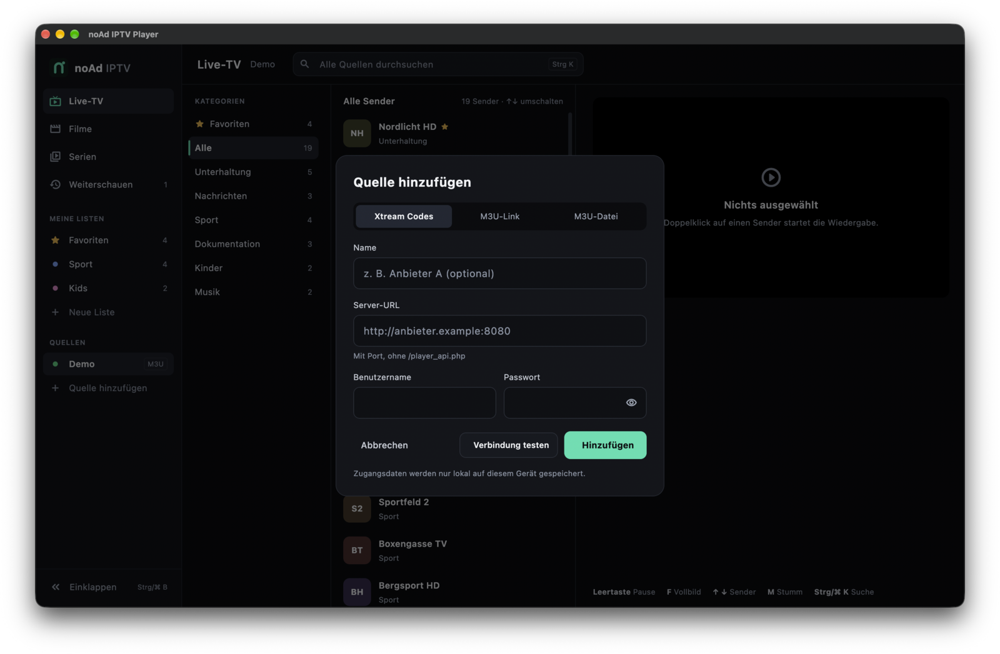
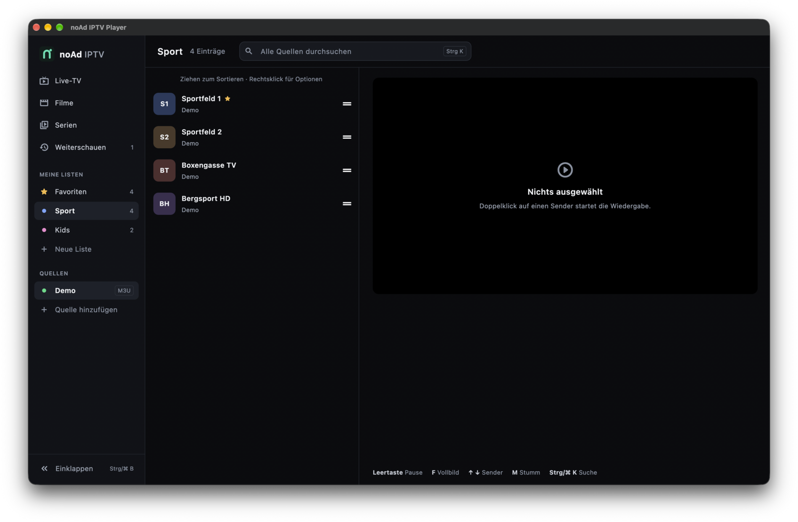

# noAd IPTV Player

**Ein schlanker, werbefreier IPTV-Player für Windows und macOS.**
Live-TV, Filme und Serien aus deinen Xtream- und M3U-Zugängen – in einer aufgeräumten, schnellen Oberfläche.

[**Herunterladen**](https://github.com/Baenji/noad-iptv-player/releases/latest) · [Funktionen](#funktionen) · [Installation](#herunterladen) · [Tastenkürzel](#tastenkürzel) · [FAQ](#häufige-fragen)

 

 

## Funktionen

| | |
|---|---|
| **Alle Quellen an einem Ort** | Beliebig viele Xtream-Codes-Zugänge, M3U-Links und M3U-Dateien nebeneinander. |
| **Live-TV, Filme & Serien** | Kategorien, Senderlogos, Poster und Serien mit Staffeln und Episoden. |
| **Suche über alles** | Ein Suchfeld findet Sender, Filme und Serien in allen Quellen gleichzeitig. |
| **Favoriten & eigene Listen** | Stelle Sender aus verschiedenen Quellen zu Listen wie „Sport“ oder „Kids“ zusammen – per Ziehen sortierbar. |
| **Weiterschauen** | Filme und Episoden starten genau dort, wo du aufgehört hast. |
| **Starker Player** | Basiert auf libmpv: spielt praktisch jedes Format, ohne dass VLC installiert sein muss. |
| **Für Tastatur gemacht** | Mit ↑ / ↓ durch die Sender zappen, Vollbild mit F, Suche mit ⌘/Strg + K. |
| **Aufgeräumt** | Dunkles Design, einklappbare Seitenleiste, frei verstellbare Spalten – keine Werbung, kein Tracking. |
| **Automatische Updates** | Die App meldet sich, sobald eine neue Version verfügbar ist. |

 

<table>
  <tr>
    <td width="50%"></td>
    <td width="50%"></td>
  </tr>
  <tr>
    <td align="center">Vollbild mit automatisch ausblendender Steuerung</td>
    <td align="center">Filme und Serien mit „Weiterschauen“</td>
  </tr>
  <tr>
    <td width="50%"></td>
    <td width="50%"></td>
  </tr>
  <tr>
    <td align="center">Quelle hinzufügen – Xtream, M3U-Link oder Datei</td>
    <td align="center">Eigene Listen über alle Quellen</td>
  </tr>
</table>

 

## Herunterladen

Die aktuelle Version findest du immer unter **[Releases](https://github.com/Baenji/noad-iptv-player/releases/latest)**.

### Windows (10 und 11)

1. Lade **`noAd-IPTV-Setup-x.y.z.exe`** herunter.
2. Starte die Datei und wähle, ob du für **alle Benutzer** (Programme-Ordner) oder **nur für dich** installieren möchtest.
3. Falls Windows SmartScreen warnt: **„Weitere Informationen“ → „Trotzdem ausführen“**.
4. noAd findest du anschließend im Startmenü.

**Update:** Neue Version herunterladen und einfach darüber installieren – Quellen, Favoriten und Listen bleiben erhalten.

### macOS (Apple Silicon und Intel)

1. Lade **`noAd-IPTV-macOS.zip`** herunter und öffne sie per Doppelklick.
2. Ziehe **„noAd IPTV Player“** in den Ordner **Programme**.
3. Beim ersten Start meldet macOS, dass die App nicht überprüft werden kann. Öffne dann
   **Systemeinstellungen → Datenschutz & Sicherheit** und klicke unten auf **„Dennoch öffnen“**.
   Das ist nur einmal nötig.

**Update:** Neue App in „Programme“ ziehen und die alte ersetzen – deine Daten bleiben erhalten.

### Loslegen

Beim ersten Start fragt noAd nach deiner Quelle:

- **Xtream Codes** – Server-URL (mit Port), Benutzername und Passwort deines Anbieters
- **M3U-Link** – der Link zu deiner Playlist
- **M3U-Datei** – eine lokale `.m3u`/`.m3u8`-Datei

Mit **„Verbindung testen“** siehst du vor dem Speichern, ob alles passt.

 

## Tastenkürzel

| Taste | Aktion |
|---|---|
| <kbd>Leertaste</kbd> | Pause / Weiter |
| <kbd>F</kbd> | Vollbild |
| <kbd>Esc</kbd> | Vollbild beenden |
| <kbd>↑</kbd> / <kbd>↓</kbd> | Vorheriger / nächster Sender |
| <kbd>←</kbd> / <kbd>→</kbd> | 10 Sekunden zurück / vor (Filme und Serien) |
| <kbd>M</kbd> | Stumm |
| <kbd>Z</kbd> | Senderliste im Vollbild |
| <kbd>⌘</kbd>/<kbd>Strg</kbd> + <kbd>K</kbd> | Suche |
| <kbd>⌘</kbd>/<kbd>Strg</kbd> + <kbd>B</kbd> | Seitenleiste ein-/ausklappen |

 

## Häufige Fragen

<b>Bringt noAd Sender oder Inhalte mit?</b>

 
Nein. noAd ist ein reiner Player. Du brauchst einen eigenen Zugang (Xtream Codes oder M3U-Playlist) von einem Anbieter deiner Wahl. Bitte nutze nur Quellen, für die du eine Berechtigung hast.

<b>Wo werden meine Zugangsdaten gespeichert?</b>

 
Ausschließlich lokal auf deinem Gerät. noAd hat keinen eigenen Server, sammelt keine Daten und enthält kein Tracking. Die einzige Verbindung außer zu deinem Anbieter ist die Update-Prüfung bei GitHub.

<b>Ein Sender startet nicht – woran liegt das?</b>

 
Meist ist der Sender beim Anbieter gerade offline oder dein Zugang erlaubt nur eine bestimmte Anzahl gleichzeitiger Streams. Läuft der Sender auf einem anderen Gerät, beende ihn dort und klicke auf „Erneut versuchen“.

<b>Gibt es noAd auch für Android oder iPhone?</b>

 
Eine Handy-Version ist geplant.

 

## Danksagung

- Wiedergabe über [libmpv](https://mpv.io) mit [media_kit](https://github.com/media-kit/media-kit), Oberfläche mit [Flutter](https://flutter.dev)
- Die Screenshots zeigen frei erfundene Sendernamen und Ausschnitte aus den Open Movies „Big Buck Bunny“ und „Sintel“ – © Blender Foundation | [www.blender.org](https://www.blender.org), lizenziert unter [CC BY 3.0](https://creativecommons.org/licenses/by/3.0/)

 

noAd IPTV Player · keine Werbung, kein Tracking

